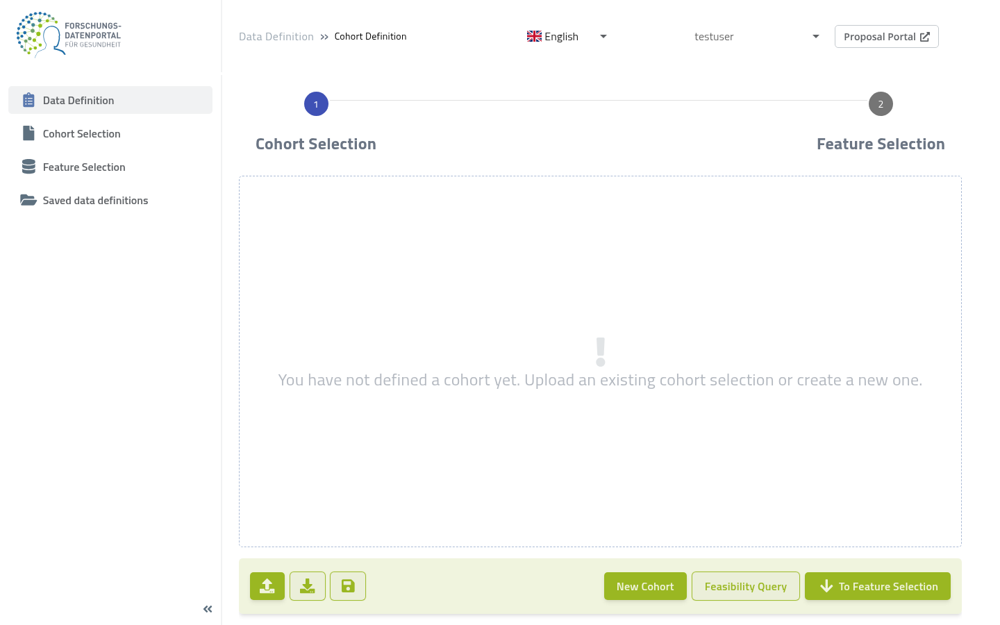
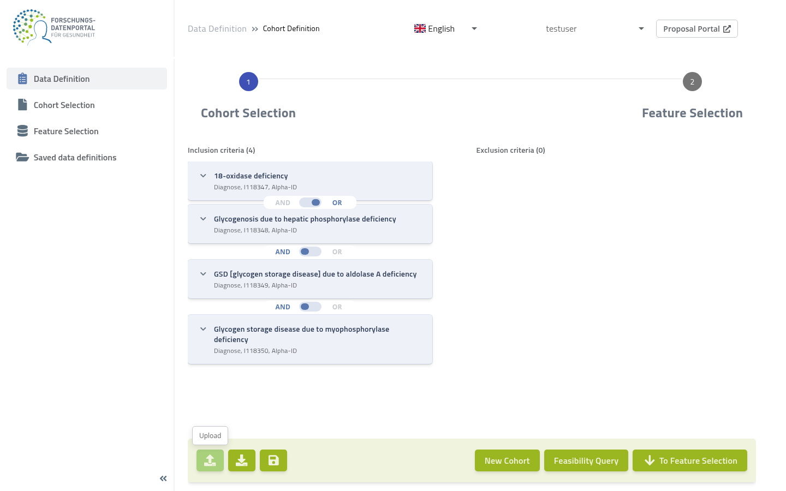
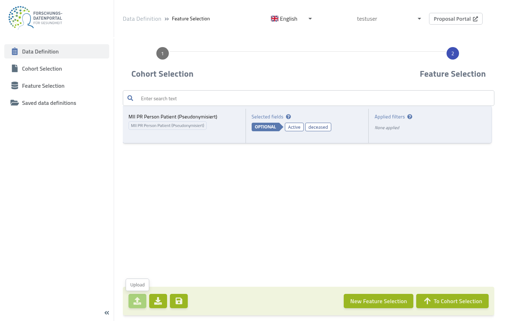

# Data Definition

The Data Definition combines the [Cohort Selection](./feasibility) and the [Feature Selection](./data-selection) into one request. It has two steps, shown as a stepper at the top:

1. **Cohort Selection**: the inclusion and exclusion criteria
2. **Feature Selection**: the selected features

The cohort, the features and the Data Definition page share the same state. A criterion you add in the Cohort Selection shows up here, and the other way round.

## Empty state



Without a cohort, the page says *You have not defined a cohort yet. Upload an existing cohort selection or create a new one.*

- **New Cohort** opens the criteria search.
- **Upload** loads a CRTDL file.
- **Feasibility Query** and **Save** are disabled.

## Step 1: Cohort Selection



The step shows the inclusion and exclusion criteria with their AND/OR connections. **Feasibility Query** runs the query, as in the [Result](./feasibility#result) page. **To Feature Selection** moves to step 2.

## Step 2: Feature Selection



The step shows the selected features. Use **Feature Selection** in the side navigation to add or change features.

## Upload and download (CRTDL)

A data definition is stored as a CRTDL JSON file:

```json
{
  "display": "",
  "version": "http://json-schema.org/to-be-done/schema#",
  "cohortDefinition": {
    "inclusionCriteria": [[ { "termCodes": [ … ], "context": { … } } ]],
    "exclusionCriteria": [ … ]
  },
  "dataExtraction": {
    "attributeGroups": [ … ]
  }
}
```

In `inclusionCriteria`, the outer list is connected with AND and each inner list with OR. In `exclusionCriteria` it is the other way round.

**Upload** replaces the current cohort and features with the file content. **Download** saves the current data definition. A download of an uploaded file gives the same data definition back, including:

- time restrictions (before, at, after, between)
- one or several concepts in attribute and value filters
- quantity filters with comparator and unit, and quantity ranges

### Upgrade of old files

Older CRTDL files can use filter names that changed since. The UI upgrades them on upload. Example: a date filter `onset-date` with only a start date becomes `recorded-date`. The upload opens the **Log** dialog with *The filter has been updated*.

### Invalid files

The upload checks the file before it replaces anything. If the file is invalid, the current cohort stays and the UI shows a message:

| File content                                     | Message contains                              |
| ------------------------------------------------ | --------------------------------------------- |
| Not JSON                                         | *is not valid JSON*                           |
| JSON without a data definition, for example `{}` | *required property 'cohortDefinition' not found* |
| Unknown property, for example `{"inclusionCriteria":1}` | *is not defined in the schema*        |
| Broken reference filter                          | Validation error                              |
