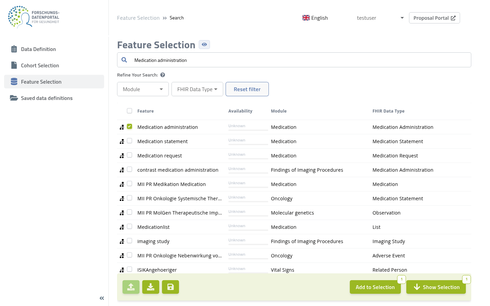
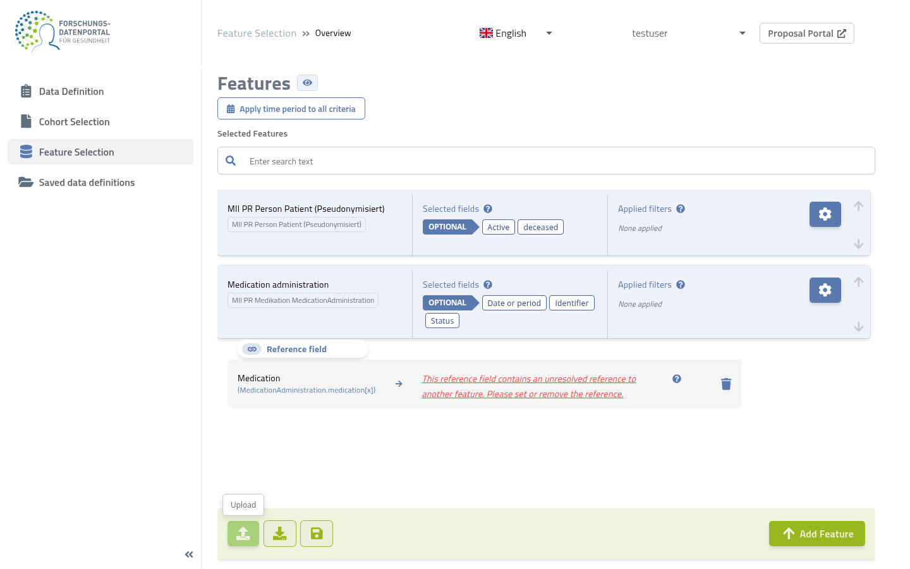
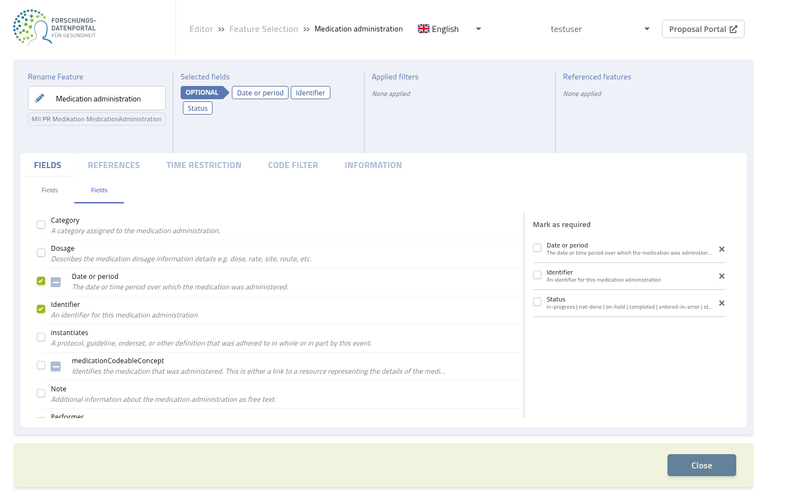
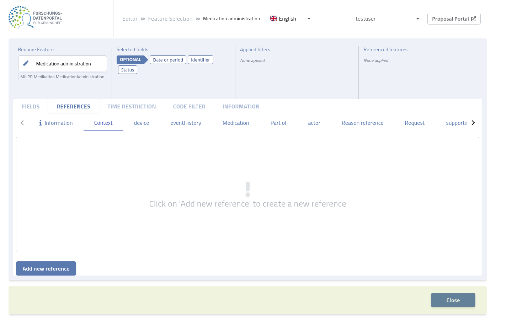

# Feature Selection

In the Feature Selection you define which data you want to receive for the patients of your cohort. Each data type is a **feature**, based on a FHIR profile of the MII core data set, for example *Medication administration* or *Diagnosis*.

::: tip Consultation
The FDPG recommends booking a consultation for the feature selection. Save intermediate results with **Save** in the action bar.
:::

The workflow has three pages:

1. [Search](#search): find features and add them
2. [Overview](#overview): see all selected features and their fields
3. [Profile editor](#profile-editor): choose fields, references and filters of one feature

## Search

Open **Feature Selection** in the side navigation and type a term into the search field. Each row shows the feature, its availability, the CDS module and the FHIR data type. Narrow the search with **Module** and **FHIR Data Type**.

1. Tick one or more features. The checkbox in the table header ticks every loaded row; click it again to clear the selection.
2. Click **Add to Selection**. It is disabled while nothing is ticked.
3. Click **Show Selection** to open the overview.

A search without matches shows no rows, says so, and offers nothing to add.

## Overview

Every selected feature is shown as a box with:

- **Selected fields**: the fields you will receive, grouped by *required* and *optional*
- **Applied filters**: time restriction and code filters
- **Reference field**: links to other features (see [References](#references))

The patient feature (*MII PR Person Patient*) is always part of the selection.

The menu of a box offers **Configure** (opens the profile editor), **Duplicate** and **Delete**. **Apply time period to all criteria** sets one time restriction on every feature. A deleted feature stays deleted after that.

## Profile editor

**Configure** opens the profile editor. The header shows the feature name (you can rename it), the selected fields, the applied filters and the referenced features. Below are five tabs.

### Fields

Tick a field to add it to **Selected fields**. Untick a default field to remove it. Removing a field in the header panel also unticks it in the list.

Each selected field is **optional** by default. Switch it to **required** to receive only patients that have this field, and switch it back the same way.

### References

Some FHIR resources point to other resources. *Medication administration*, for example, points to a *Medication*. The References tab has one sub-tab per reference field.

A box with an **unresolved recommended reference** shows a warning: *This reference field contains an unresolved reference to another feature. Please set or remove the reference.* Only boxes with such a reference show it.

To resolve the warning, either:

- **Link** the reference: click the warning (it opens the profile editor on the right tab), then **Add new reference** and pick a feature. The linked feature shows as a chip under **Selected Reference**. You can link one reference to several features.
- **Remove** the reference field.

Linking one reference clears only that warning. Unlinking the only linked feature brings the warning back.

A linked reference has a **Required** option. It can be switched on and off repeatedly.

#### Only if referenced

A feature that another feature links to offers **Only if referenced**. When on, you receive this feature's data only where the other feature points to it. The option:

- becomes available as soon as a feature links to it
- keeps its state when **Required** of the same box is toggled
- is reset when the last link to the feature is removed

### Time restriction

Works as in the [criterion editor](./feasibility#time-restriction): **before**, **at**, **after**, **between**. The restriction shows as a chip in the header and stays when you switch tabs. For **between**, the start date must be earlier than the end date.

### Code filter

Limits the feature to certain codes, for example a medication by its ATC code. Search a concept, tick it, and it shows as a chip under **Applied filters**. Remove the chip to remove the filter. The same code in two code systems counts as two different concepts.

A code filter can also be added to a feature loaded from a file that already has a date filter.

### Information

Explains fields, references, time restriction and concepts for this feature.

Click **Close** to return to the overview.
