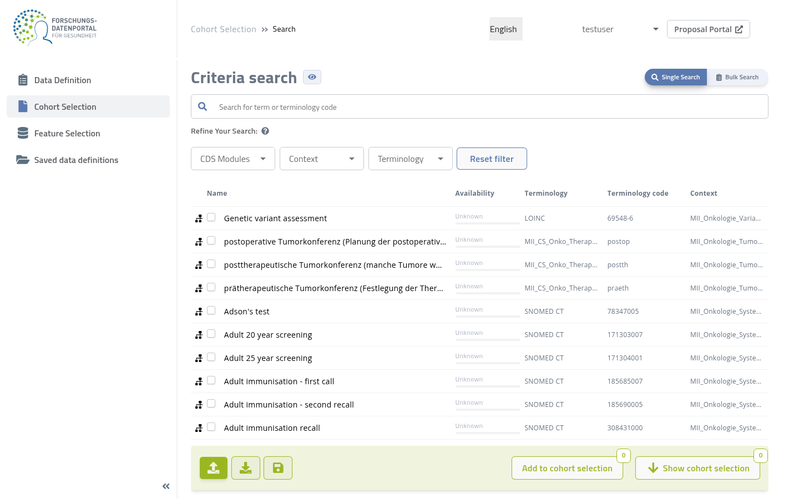
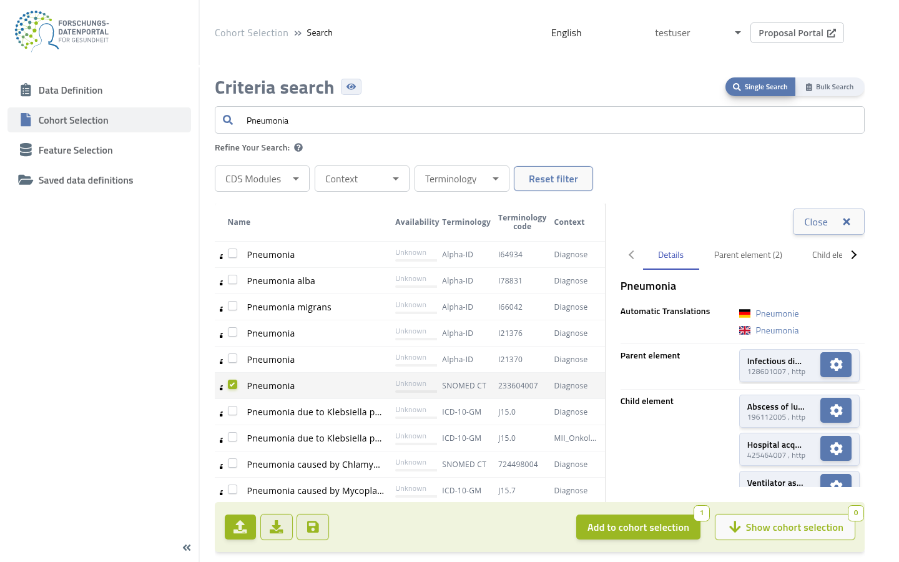
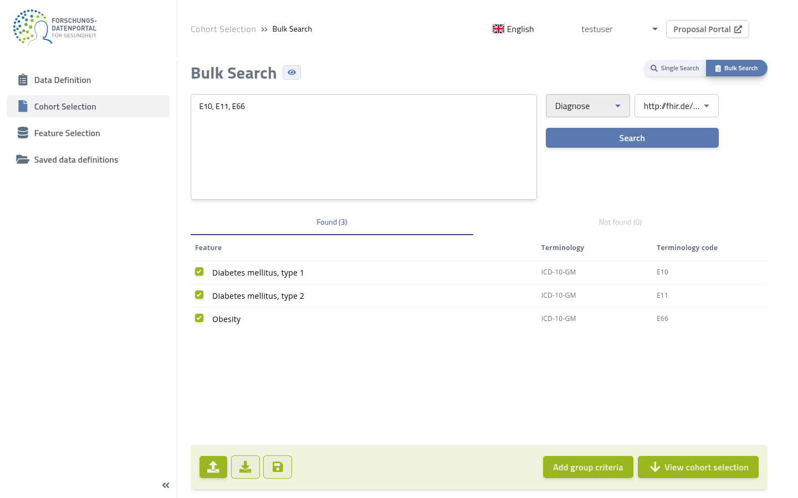
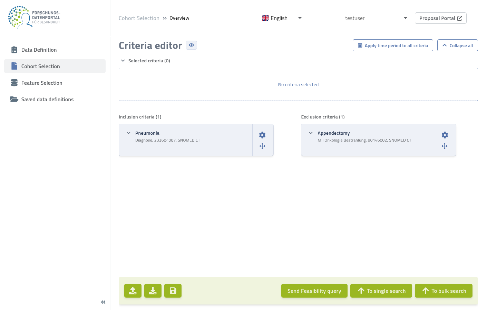
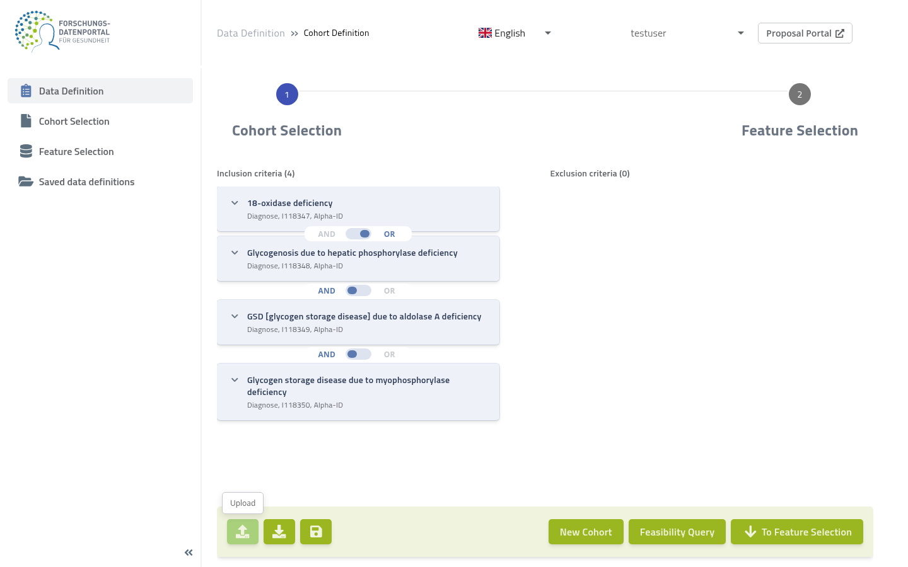
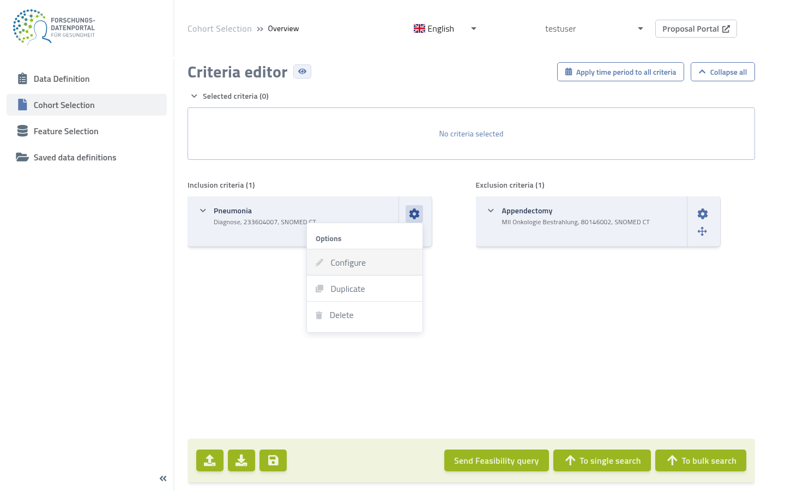
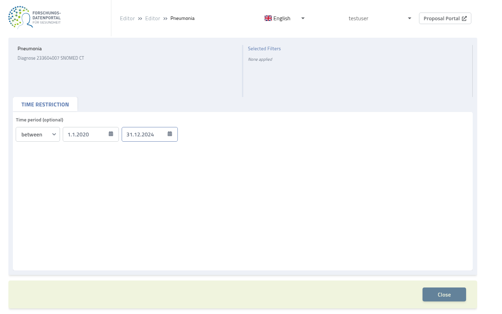
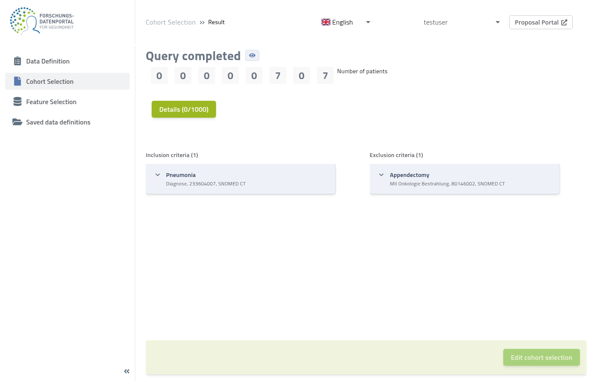
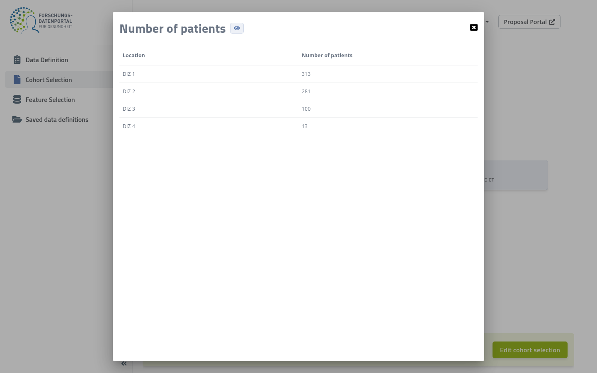

# Cohort Selection (Feasibility)

In the Cohort Selection you define which patients belong to your cohort. You pick criteria (diagnoses, procedures, lab values, medication, consent, …), sort them into inclusion and exclusion lists, and send a **feasibility query**. The result is an estimate of how many patients match, across all sites.

The workflow has three pages:

1. [Search](#search): find criteria and add them to the selection
2. [Editor](#editor): place the criteria, connect them and add filters
3. [Result](#result): see the patient count and the count per site

## Search

Open **Cohort Selection** in the side navigation. The page starts with the first 20 criteria.

### Single search

Type a term or a terminology code into the search field, for example `Pneumonia` or `233604007`. The table updates while you type. Clear the field to get back to the first 20 criteria.

Each row shows:

| Column           | Meaning                                                       |
| ---------------- | ------------------------------------------------------------- |
| Name             | Name of the criterion                                         |
| Availability     | How many sites have data for it                               |
| Terminology      | Code system, for example SNOMED CT, ICD-10-GM, LOINC, Alpha-ID |
| Terminology code | Code in that system                                           |
| Context          | Where the criterion applies, for example `Diagnose`, `Procedure`, `Laboruntersuchung` |

Narrow the search with the filters **CDS Modules**, **Context** and **Terminology**. **Reset filter** removes them.

The same name can appear several times, once per terminology or context. Check the columns before you select a row.

### Add criteria

1. Tick the checkbox of one or more rows.
2. Click **Add to cohort selection**. The badge on the button counts the ticked rows.
3. Repeat for further criteria.
4. Click **Show cohort selection** to open the editor. Its badge counts the criteria already added.

Both buttons are disabled while nothing is ticked or added.

### Details panel

Click a row name to open the details panel on the right. It shows:

- **Details**: name and automatic translations (German and English)
- **Parent element** and **Child element**: related criteria in the terminology hierarchy

Click a related criterion to show its details in the same panel. Its options button can also use it as the new search term. Close the panel with **Close**, or click the same row again.

### Bulk search

The bulk search turns many codes into **one** criterion. The codes are connected with OR.

1. Open the **Bulk Search** tab.
2. Paste the codes. Separate them with commas, spaces or line breaks: `E10, E11, E66`.
3. Select the **Terminology**, for example ICD-10-GM.
4. Select the **Context**, for example `Diagnose`.
5. Click **Search**. The button is enabled only when codes, terminology and context are set.

The result has two tabs: **Found** and **Not found**. A code that does not exist in the terminology, such as `ZZZ99`, is listed under **Not found**.

Click **Add group criteria** to add the found codes as one criterion. In the editor, the criterion lists all its codes. You can remove codes down to the last one.

## Editor

The editor has three areas:

| Area                  | Meaning                                                          |
| --------------------- | ---------------------------------------------------------------- |
| **Selected criteria** | New criteria land here. They are not part of the query yet.     |
| **Inclusion criteria**| Patients must match these criteria.                              |
| **Exclusion criteria**| Patients who match these criteria are removed from the cohort.   |

Drag a criterion by its move handle (four arrows) into the inclusion or exclusion list. You can drag criteria back to **Selected criteria**, between the lists, and inside a list.

**Send Feasibility query** is enabled when the inclusion list has at least one criterion and every mandatory filter is set.

### AND and OR

Between two criteria in a list there is a switch:

- **AND**: the patient must match both criteria.
- **OR**: the patient must match at least one of them.

Criteria connected with OR form a **group**. The rules:

- Switching AND to OR merges the two neighbours into one group. Switching it back splits the group again.
- Switching every connection to OR builds one group.
- A criterion dragged out of a group leaves the other criteria of the group connected.
- A criterion dropped in the middle of an OR group joins that group. Dropped after the last criterion of an AND chain, it forms its own group.
- A criterion dragged to **Selected criteria** and back keeps its place and shows only once.
- Moving a criterion inside a list keeps the connections of the other criteria.

### Criterion options

The gear button on a criterion opens its menu:

| Entry         | Action                                                   |
| ------------- | -------------------------------------------------------- |
| **Configure** | Opens the criterion editor to set filters                |
| **Duplicate** | Adds a copy of the criterion to **Selected criteria**    |
| **Delete**    | Removes the criterion from the editor                    |

**Apply time period to all criteria** sets the same time restriction on every criterion at once. **Collapse all** folds the cards.

### Criterion editor (filters)

**Configure** opens the criterion editor. It shows only the filters this criterion supports. A criterion without filters, for example a consent criterion, has no filter tabs and can be used as is.

Applied filters show as chips in the header (**Selected Filters**) and on the criterion card in the editor. Click **Close** to return.

#### Time restriction

Limits the criterion to a time period. Choose an operator and a date:

| Operator    | Meaning                                    |
| ----------- | ------------------------------------------ |
| **before**  | on or before the date                      |
| **at**      | on the date                                |
| **after**   | on or after the date                       |
| **between** | from the first to the second date          |
| **No filter** | no time restriction                      |

For **between**, the start date must be earlier than the end date. Otherwise the editor shows *The start date must be earlier than the end date* and does not apply the filter. A valid range shows as a chip like *From 01.01.2045 to 04.04.2045*.

#### Value filter: quantity

Some criteria carry a numeric value, for example `Current chronological age` in years. The operator offers exactly: **No filter**, **equal**, **less than**, **greater than**, **between**.

- Set the value and the unit. The chip shows operator, value and unit.
- For **between**, the minimum must be less than the maximum. Otherwise the editor shows *The minimum value must be less than the maximum value*.

::: warning Mandatory value filter
Some criteria need a value filter. While it is not set, **Send Feasibility query** stays disabled. Example: `Current chronological age` needs an operator, a value and a unit.
:::

#### Value filter and attribute filter: concept

Concept filters limit a criterion to certain codes, for example a specific stage or severity.

1. Search a concept in the filter tab.
2. Tick one or more concepts. They appear in the **Selected** tab, and its label counts them.
3. Remove a concept in the **Selected** tab, or untick it in the search results.

Rules:

- Each attribute keeps its own selection. Removing a concept in one attribute does not change the others.
- The value filter selection is independent of the attribute filters.
- Two criteria of the same profile keep separate selections.
- Selections stay after closing and reopening the editor, and selected concepts stay ticked after a new search.
- The **Selected** tab is disabled while nothing is selected.
- The same code in two code systems counts as two different concepts.

## Result

**Send Feasibility query** opens the result page. The UI sends the query once and then asks the backend for the result at regular intervals (*polling*).

- The patient count appears as soon as the first result arrives. It can still change while polling runs.
- The count is approximate. A result below the privacy threshold shows a message instead of details.
- The inclusion and exclusion criteria of the query are shown below.
- **Edit cohort selection** returns to the editor. Opening the result again sends the query again.

### Details per site

**Details** opens a dialog with the number of patients per site. The button label shows your detail requests used and the limit, for example *Details (0/1000)*.

- The details are loaded once per result. Further clicks do not send a new request.
- The button is disabled when polling got no result, when the result is below the privacy threshold, and when the result has expired.

See [Errors and Messages](./errors#feasibility-result) for every result message.
