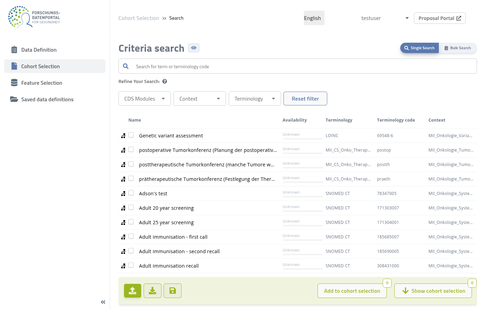
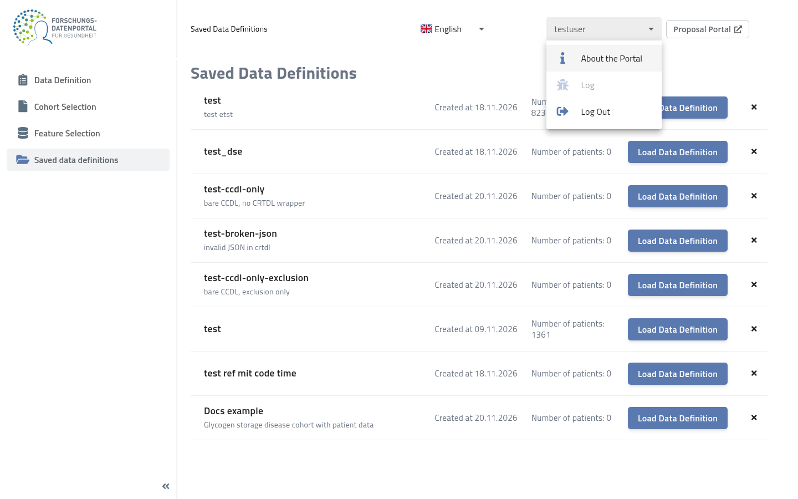

# Overview

The Dataportal UI helps researchers in two steps:

1. **Cohort Selection**: define which patients you want. The UI estimates how many patients match, across all sites (a *feasibility query*).
2. **Feature Selection**: define which data you want from these patients.

Both parts together form a **Data Definition**. You can upload, download and save it as a CRTDL file (Clinical Research Topic Data Language, JSON).

## Layout

| Area             | Content                                                                              |
| ---------------- | ------------------------------------------------------------------------------------ |
| Side navigation  | **Data Definition**, **Cohort Selection**, **Feature Selection**, **Saved data definitions** |
| Header           | Breadcrumb, language switch, user menu, link to the **Proposal Portal**               |
| Action bar       | Upload, download, save, and the next step of the current page                        |

### Side navigation

The side navigation lists the four main areas. The button `«` at the bottom collapses it. When collapsed, only the icons are shown. Click the button again to show the labels.

### Language

The language switch in the header changes the UI between **German** (default) and **English**. The chosen language stays when you move between pages inside the app.

::: tip
A full page reload starts in German again.
:::

### User menu

Click your user name to open the user menu:

| Entry               | Action                                                                   |
| ------------------- | ------------------------------------------------------------------------ |
| **About the Portal**| Opens a dialog with the UI and backend versions                          |
| **Log**             | Shows the errors of this session. Disabled while there are no errors.    |
| **Log Out**         | Ends the session and returns to the sign-in page                         |

### Action bar

The action bar at the bottom of each page holds the actions for the current data definition:

| Button   | Action                                                                     |
| -------- | -------------------------------------------------------------------------- |
| Upload   | Load a CRTDL file. Replaces the current cohort and feature selection.       |
| Download | Save the current data definition as a CRTDL file                           |
| Save     | Save the data definition on the server (see [Saved Data Definitions](./saved-queries)) |

Download and Save are disabled while the data definition is invalid, for example when the cohort has no inclusion criterion. The tooltip says *The data definition is invalid.*

The editors for a single criterion or feature hide the action bar. Close the editor to get it back.

## Where to go next

- [Cohort Selection](./feasibility): search criteria, build the cohort, run a feasibility query
- [Feature Selection](./data-selection): pick the data you need
- [Data Definition](./data-definition): combine both, upload and download
- [Saved Data Definitions](./saved-queries)
- [Errors and Messages](./errors)
