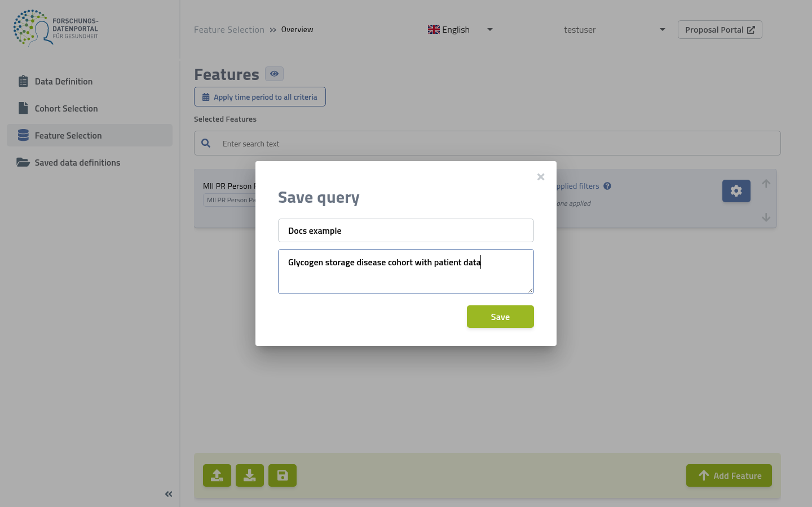
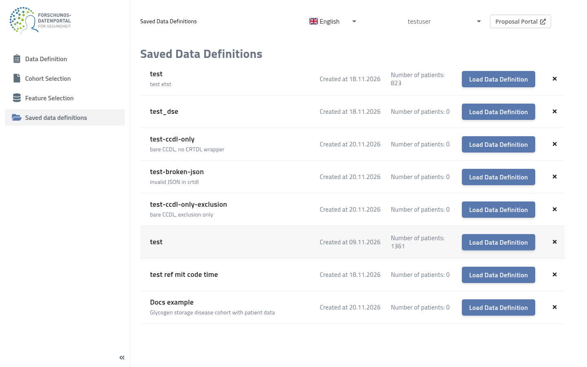

# Saved Data Definitions

You can save a data definition on the server and load it later.

## Save

1. Click **Save** in the action bar. It is disabled while the data definition is invalid.
2. Enter a **Title**. **Save** stays disabled without a title.
3. Optionally enter a **Comment**.
4. Click **Save**.

## List

Open **Saved data definitions** in the side navigation. Each entry shows title, comment, creation date and the number of patients of its last feasibility query.

| Action                   | Result                                                          |
| ------------------------ | --------------------------------------------------------------- |
| **Load Data Definition** | Replaces the current cohort and features and opens the Data Definition |
| `×`                      | Asks for confirmation, then deletes the entry                   |
